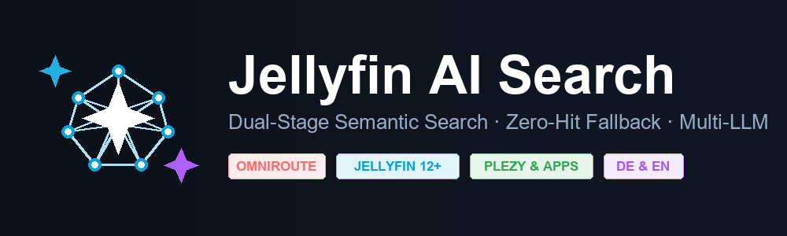
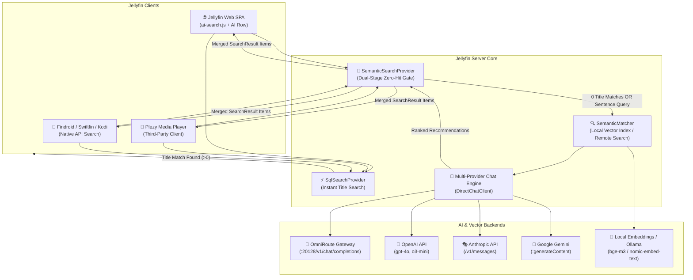

<div align="center">



# 🧠 Universal AI Search & Smart Recommendations for Jellyfin (`Jellyfin.Plugin.AiSearch`)

**Natural Language Semantic Search, Dual-Stage Zero-Hit Fallback, Multi-Provider LLM Gateway & Third-Party Client Bridge (Plezy, Findroid, Swiftfin, Web)**

[](https://dotnet.microsoft.com/)
[](https://jellyfin.org/)
[](https://github.com/FaserF/Jarvis)
[](#-multi-provider-ai-engine)
[](#-third-party-app-support)
[](#-native-i18n-localization)
[](LICENSE)

*Ask in natural language, describe a mood, tone, or setting, and receive intelligent recommendations from your personal media library. Features **instant direct title matching**, **intelligent zero-hit recommendation fallback**, **multi-stage progress tracking**, and native integration with **Plezy**, **Findroid**, and **Swiftfin**.*

</div>

---

## 📖 Table of Contents

1. [Overview & Core Philosophy](#-overview--core-philosophy)
2. [System Architecture](#-system-architecture)
3. [Key Features Breakdown](#-key-features-breakdown)
   - [1. Intelligent Dual-Stage Search (Zero Overhead Title Search + Zero-Hit Fallback)](#1-intelligent-dual-stage-search)
   - [2. Universal Third-Party Client Integration (Plezy, Findroid, Swiftfin, Kodi)](#2-universal-third-party-client-integration)
   - [3. Multi-Provider AI Engine (OmniRoute, OpenAI, Anthropic Claude, Google Gemini)](#3-multi-provider-ai-engine)
   - [4. Native German (DE), English (EN) & French (FR) Localization](#4-native-i18n-localization)
   - [5. Visual Zero-Hit Guidance & Animated Progress Feedback](#5-visual-zero-hit-guidance--progress-feedback)
   - [6. Personalized Recommendation & Taste Profile Engine](#6-personalized-recommendation--taste-profile-engine)
   - [7. Local Vector Embeddings or Remote Retrieval](#7-local-vector-embeddings-or-remote-retrieval)
4. [Installation & Repository Setup](#-installation--repository-setup)
   - [Fixing "Developer: Unknown / Repository: Unknown"](#fixing-developer-unknown--repository-unknown)
5. [Configuration Reference (`PluginConfiguration`)](#-configuration-reference)
6. [API Endpoints Reference (`/AiSearch/*`)](#-api-endpoints-reference)
7. [Scheduled Tasks](#-scheduled-tasks)
8. [Credits & Attribution](#-credits--attribution)

---

## 🌟 Overview & Core Philosophy

Standard media server search is strictly syntactic: typing `"space horror"` or `"mind bending thriller"` yields zero results unless a movie literally contains those exact words in its title. Conversely, running heavy AI semantic pipelines on every single keystroke slows down straightforward title searches (`"Inception"`, `"Breaking Bad"`) with unwanted latency.

**`Jellyfin.Plugin.AiSearch`** solves this with an **intelligent dual-stage pipeline**:

1. **Instant Title Search First:** When a user types a specific movie or series title, Jellyfin's built-in `SqlSearchProvider` returns immediate results with **0 ms AI overhead**.
2. **Zero-Hit Semantic Fallback:** If zero title matches exist in the library, or if the user enters a descriptive natural-language sentence, the AI search engine triggers automatically, surfacing matching titles based on meaning, themes, and moods.
3. **Universal Third-Party Compatibility:** Operates directly inside Jellyfin's `IInternalSearchProvider` pipeline, meaning apps like **Plezy**, **Findroid**, and **Swiftfin** automatically receive smart recommendations with no special client plugins required.
4. **Fleet-Ready Multi-Provider AI:** First-class zero-config support for **OmniRoute** (`http://omniroute:20128/v1`), **OpenAI**, **Anthropic Claude** (`/v1/messages`), and **Google Gemini** (`/v1beta/models/...:generateContent`).

---

## 🏗 System Architecture



---

## 🚀 Key Features Breakdown

### 1. Intelligent Dual-Stage Search
- **Instant Title Resolution:** Short title searches query Jellyfin's internal catalog index in `< 1 ms`. If a direct title match exists, semantic search steps aside immediately.
- **Zero-Hit AI Fallback:** When a title search returns 0 matches (e.g. asking for a movie not in your library or entering a thematic query), semantic vector matching activates and recommends closely related movies and shows.
- **Natural Language Sentence Detection:** Descriptive sentences (e.g. *"dark mystery thriller with plot twist"*, *"entspannter Film für Sonntagabend"*) automatically bypass title filtering and generate relevant recommendations.

### 2. Universal Third-Party Client Integration
- Third-party players like **Plezy**, **Findroid**, **Swiftfin**, and **Kodi** communicate with Jellyfin via `/Items?searchTerm=...` or `/Search/Hints`.
- Because `SemanticSearchProvider` implements Jellyfin's native `IInternalSearchProvider`, zero-hit recommendations are returned as standard `SearchResult` items with calibrated relevance scores ($1 \dots 49$), allowing Plezy to display recommendations seamlessly without modifying the app.

### 3. Multi-Provider AI Engine
Configurable with pre-built provider presets and a 1-click connection test button:
- **OmniRoute (Fleet Gateway - Primary):** Pre-configured default (`http://omniroute:20128/v1/chat/completions`). High-speed, rate-limit-aware proxying across fleet accounts.
- **OpenAI:** Official OpenAI endpoints with automatic parameter negotiation (`max_tokens` vs. `max_completion_tokens`).
- **Anthropic Claude:** Direct support for Anthropic's `/v1/messages` format, handling `x-api-key`, system prompt segregation, and role formatting.
- **Google Gemini:** Native support for Google Generative Language API (`/v1beta/models/{model}:generateContent`) with `x-goog-api-key`.
- **Custom / Self-Hosted:** Full compatibility with Ollama, LocalAI, vLLM, and LiteLLM.

### 4. Native i18n Localization
- **German (`de`):** Full native German localization for all web interface components, popup dialogues, buttons, and AI prompt instructions.
- **English (`en`):** Clean, idiomatic English interface and system prompts.
- **French (`fr`):** Complete French translation maintained from upstream.
- **Auto-Detection:** Automatically matches each user's Jellyfin display language, falling back to browser locale.

### 5. Visual Zero-Hit Guidance & Progress Feedback
- **Zero-Hit Notice Banner:** When a search has no direct title matches, Jellyfin Web displays a clear indicator banner:
  > *„Keine direkten Treffer für „{query}“ — hier sind passende KI-Empfehlungen aus deiner Mediathek:“*
- **Animated Multi-Stage Progress:** Displays an animated gradient progress bar while the model retrieves candidates and formulates recommendations.

### 6. Personalized Recommendation & Taste Profile Engine
- Considers user favorites and watched history as optional taste signals.
- Generates a local, private viewer taste profile to bias recommendations without invading privacy or requiring cloud-synced user tracking.

### 7. Star Ratings Ecosystem & Suggestarr Auto-Downloads
- **Native Synergy with [K3ntas Ratings Plugin](https://github.com/K3ntas/jellyfin-plugin-ratings) & Plezy:**
  - Integrates seamlessly with `K3ntas/jellyfin-plugin-ratings` and native Jellyfin `IUserDataManager.UserDataSaved` events.
  - Automatically captures 1–10 star community ratings from the web UI and external clients like **Plezy**, normalizing them to high-precision 1–5 star preferences.
  - User-loved titles (4–5★) strongly bias recommendation themes, directors, and genres (`USER_LOVED`).
  - Disliked titles (1–2★) are penalized and avoided in recommendation prompts (`USER_DISLIKED`).
- **Suggestarr & Seerr Integration:**
  - Automated Suggestarr / Jellyseerr / Overseerr request dispatch when a user rates media with $\ge 4$ stars.
  - Dedicated official Suggestarr feed endpoint at `GET /AiSearch/Suggestarr/Feed?userId={userId}&minStars=4` for scheduled Suggestarr suggestion import jobs.

---

## 📦 Installation & Repository Setup

### Adding the Official Plugin Repository (Recommended)

Adding the repository manifest ensures one-click updates directly inside the Jellyfin Dashboard and eliminates the *"Developer: Unknown / Repository: Unknown"* notification:

1. Open **Jellyfin Dashboard &rarr; Plugins &rarr; Repositories**.
2. Click the **+ (Add)** button.
3. Enter:
   - **Repository Name:** `FaserF Jellyfin Plugins`
   - **Repository URL:**
     ```text
     https://raw.githubusercontent.com/FaserF/jellyfin-plugin-ai-search/main/manifest.json
     ```
4. Click **Save**.
5. Navigate to **Catalog**, select **AI Search**, and click **Install**.
6. Restart your Jellyfin server.

### Fixing "Developer: Unknown / Repository: Unknown"
If you previously installed the plugin manually, Jellyfin displays:
> *An error occurred while getting the plugin details from the repository. Status: Active, Version: 1.x, Developer: Unknown, Repository: Unknown*

**Fix:** Add the repository URL above to your Jellyfin Repositories list. Once registered, Jellyfin associates the installed package GUID (`d0a3f1e6-9c2b-4a7d-8e5f-1b2c3d4e5f6a`) with the manifest, displaying full version info, changelog, and developer credits.

---

## ⚙️ Configuration Reference

| Option | Type | Default | Description |
|---|---|---|---|
| `Enabled` | `bool` | `true` | Master toggle for the AI search plugin. |
| `ChatProvider` | `string` | `"omniroute"` | Provider preset: `omniroute`, `openai`, `anthropic`, `gemini`, `custom`. |
| `ChatEndpointUrl` | `string` | *(preset)* | Full chat completions / messages URL. |
| `ChatApiKey` | `string` | `""` | API key or bearer token (leave blank for local/internal OmniRoute). |
| `Model` | `string` | `""` | Model identifier (e.g. `gpt-4o`, `claude-3-5-sonnet`, `gemini-2.0-flash`). |
| `UiLanguage` | `string` | `"auto"` | Interface language: `auto`, `de`, `en`, `fr`. |
| `SemanticSearchEnabled` | `bool` | `true` | Contributes semantic meaning-based matches to Jellyfin's search. |
| `SemanticSearchFallbackOnly` | `bool` | `true` | Only runs AI search when 0 title matches exist or for natural language queries. |
| `SemanticSearchSentencesOnly` | `bool` | `false` | When true, skips short keyword queries in native search. |
| `ShowAiSearchRow` | `bool` | `true` | Shows separate AI Search row in Jellyfin Web under native results. |
| `ExplainAiMatches` | `bool` | `true` | Calls chat model to write a short reason explaining each match. |
| `RetrievalMode` | `string` | `"local"` | Candidate source: `local` (in-memory vector index) or `remote`. |
| `EmbeddingEndpointUrl` | `string` | `""` | OpenAI-compatible embeddings endpoint (`.../v1/embeddings`). |
| `EmbeddingModel` | `string` | `""` | Embedding model ID (e.g. `bge-m3`, `text-embedding-3-small`). |

---

## 🔌 API Endpoints Reference

All endpoints reside under the `/AiSearch/*` route:

| Method | Endpoint | Description |
|---|---|---|
| `GET` | `/AiSearch/Health` | Plugin health check, configuration status, and feature flags. |
| `POST` | `/AiSearch/TestChat` | Admin test probe for validating chat endpoints and latency. |
| `POST` | `/AiSearch/Recommend` | Executes full recommendation query against library candidates. |
| `POST` | `/AiSearch/Interview` | Generates 2–3 adaptive refining questions for "Help me choose". |
| `GET` | `/AiSearch/Matches` | Fetches semantic matches for a query term (used by web client AI row). |
| `POST` | `/AiSearch/Explain` | Asks LLM to explain why specific titles matched a search term. |
| `GET` | `/AiSearch/IndexStatus` | Returns local vector index item count, dimension, and build status. |
| `POST` | `/AiSearch/RebuildIndex`| Triggers background rebuild of the local embedding vector index. |

---

## ⏱️ Scheduled Tasks

- **Build AI Search Semantic Index:** Runs in the background to scan library items, calculate embeddings via the configured embedding model, and store vectors in the server's cache directory. Subsequent searches execute in-memory with sub-millisecond scan times.

---

## 🤝 Credits & Attribution

- **Original Creator & Foundation:** Created by **Franciskid** ([`Franciskid/jellyfin-plugin-ai-search`](https://github.com/Franciskid/jellyfin-plugin-ai-search)), who designed the original in-memory vector index architecture, web injection pipeline, and French/English interface.
- **Maintenance & Enhancements:** Maintained and expanded by **Fabian Seitz ([FaserF](https://github.com/FaserF))**:
  - Intelligent dual-stage search with instant title matching and zero-hit fallback.
  - Third-party app compatibility (Plezy, Findroid, Swiftfin).
  - Multi-provider support (OmniRoute fleet gateway, Anthropic Claude, Google Gemini).
  - Native German (`de`) localization.
  - Interactive AI connection testing and visual progress indicators.

---

## 📄 License

This project is licensed under the **GNU General Public License v3.0 (GPL-3.0)**. See [LICENSE](LICENSE) for details.
